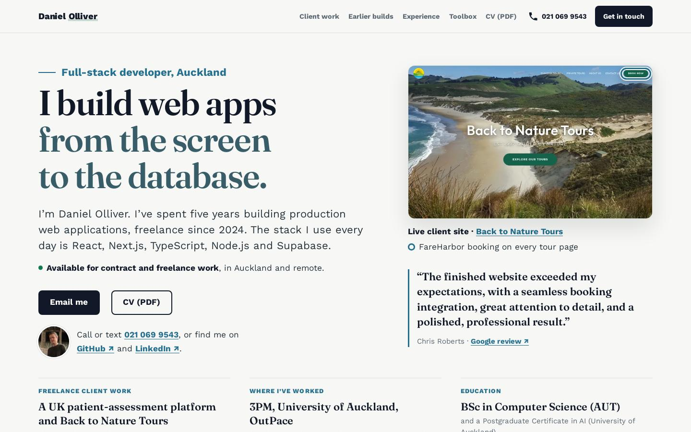
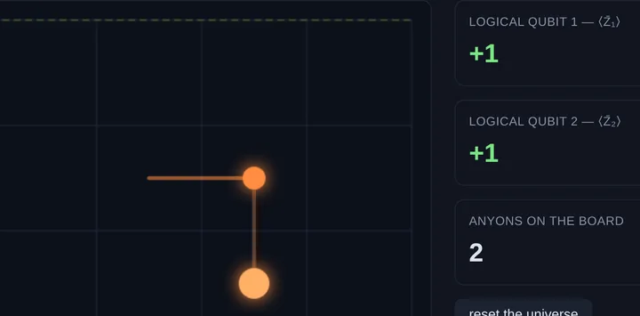
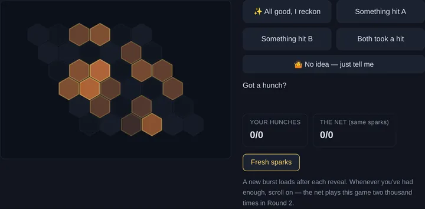

# danielolliver.com

Source of [danielolliver.com](https://danielolliver.com/), Daniel Olliver's personal site: AI and machine-learning research on the homepage, two in-browser quantum demos, and a software development portfolio at [/dev](https://danielolliver.com/dev/).



The site is plain static HTML, CSS and JavaScript in `public/`. There is no build step: Firebase Hosting serves `public/` directly (`firebase.json`, `"public": "public"`; see [Deploy](#deploy)).

## Pages

| Path | What it is | Source |
| --- | --- | --- |
| `/` | AI research homepage: the two preprints, the research notes, the essay and the demos | `public/index.html` |
| `/papers/` | The two preprints, each with a landing page (abstract, PDF and citation): `circuit-level-equivariance`, `lattice-teeth-nca` | `public/papers/` |
| `/research/` | Index of the seven research notes | `public/research/index.html` |
| `/research/<note>/` | One page per note: `braiding`, `nonabelian`, `decoder`, `qrc`, `chern`, `coldstart`, `hexlife` | `public/research/*/` |
| `/essay/` | "I spent six years believing hexagons were the key to AI. Then I tested it." | `public/essay/index.html` |
| `/anyons/` | Hex: braid anyons on a toric-code board and turn a measurement-angle dial on a six-qubit hexagon cluster state | `public/anyons/` |
| `/anyons/decoder/` | The Error-Hunting Game: trained quantum error-correction decoders running in the browser | `public/anyons/decoder/` |
| `/dev/` | Software development portfolio, with the CV at `/dev/resume.pdf` | `public/dev/` |

The two preprints (landing pages under `/papers/`, records on Zenodo):

- Olliver, D. (2026). *Circuit-level equivariance is code-dependent: obstruction in the surface code, exactness in the honeycomb Floquet code, and consequences for neural decoders* [Preprint]. Zenodo. https://doi.org/10.5281/zenodo.20715320
- Olliver, D. (2026). *The lattice's teeth: primitive reciprocal axes govern which Fourier components neural cellular automata can grow* [Preprint]. Zenodo. https://doi.org/10.5281/zenodo.21614035

The code behind the first preprint is in [equivariant-quantum-ml](https://github.com/dwatces/equivariant-quantum-ml), and its symmetry solver is published on PyPI as [demsym](https://pypi.org/project/demsym/).

## The two demos





**Hex (`/anyons/`)** runs a stabilizer simulation written in JavaScript (`engine.js`), with no server:

- `Tableau`: an Aaronson-Gottesman (CHP) stabilizer simulator with exact Pauli expectation values.
- `ToricCode`: ground-state preparation, anyon creation and dragging, syndromes and logical operators on a torus.
- `MBQCHex`: a six-qubit statevector simulation of the hexagon cluster-state magic injection.

When a visitor completes a loop, the "queue this braid on a real quantum computer" button opens a prefilled GitHub issue on equivariant-quantum-ml with the braid spec.

**The Error-Hunting Game (`/anyons/decoder/`)** loads float16 weights of trained honeycomb Floquet code decoders from `data/` and runs the forward pass in `decoder.js`. Visitors guess errors themselves, watch the network decode a stream of 2,000 shots beside precomputed minimum-weight matching answers, compare a symmetry-tied network with a plain one of the same size, and drag a slider across networks trained on 250 to 64,000 examples.

## Run it locally

The pages use root-relative paths (`/ga.js`, `/static/media/...`), so serve `public/` as the web root rather than opening the files directly:

```bash
python3 -m http.server 8000 --bind 127.0.0.1 --directory public
```

Then open http://127.0.0.1:8000/. Any static file server pointed at `public/` works. The `/resume.pdf` redirect and the cache headers apply only on Firebase, and every page loads `/ga.js`, so local visits are sent to the site's Google Analytics.

## Tests

Both demos have plain Node test scripts with no dependencies:

```bash
node public/anyons/test_engine.js           # Bell pair, toric-code loops and the logical flip, hexagon programs against their target values
node public/anyons/decoder/test_decoder.js  # JS forward pass against the PyTorch logits, and stream accuracy against data/meta.js
```

Each script exits non-zero on a failure.

## Deploy

Firebase Hosting, project `portfolio-6f211` (`.firebaserc`), with Cloudflare in front of the domain. Deploys are manual with the Firebase CLI (`npm install -g firebase-tools`):

```bash
firebase hosting:channel:deploy preview   # a preview URL to check first
firebase deploy --only hosting            # then live
```

`firebase.json` sets the cache headers (`no-cache` by default; scripts, styles, images, PDFs and fonts one hour; anything under `/static/` a year, and Cloudflare can lengthen the shorter times), 301-redirects `/resume.pdf` to `/dev/resume.pdf`, and leaves the `test_*.js` scripts and `anyons/README.md` out of the upload.

## Project structure

```
public/              the site, served by Firebase Hosting
  index.html         AI research homepage
  papers/            preprint landing pages and their PDFs
  research/          research index and the notes
  essay/             the essay
  anyons/            Hex demo (engine.js, app.js, test_engine.js)
  anyons/decoder/    Error-Hunting Game (decoder.js, app.js, data/, test_decoder.js)
  dev/               developer portfolio, CV and its assets
  assets/home/       screenshots of the two demos used on the homepage
  static/media/      self-hosted fonts
  ga.js              Google Analytics 4 loader, included on every page
  404.html, sitemap.xml, robots.txt, manifest.json, favicons
firebase.json        Hosting config: serves public/ and sets cache headers
src/, package.json   the earlier Create React App homepage (started in 2021), kept in the repo but no longer deployed
docs/                design references and screenshots (not deployed)
```

`package.json` and `src/` are the old React app, kept for its history. Its scripts no longer work: Create React App reads its page template from `public/`, which is now the static site, so don't run `npm start` or `npm run build`. The static site needs no `npm install`.

## Trade-offs

- No framework and no build step: each page carries its own inline `<style>` block, so shared styles are repeated from page to page.
- Cache-busting is by hand: most images and fonts carry a date or hash in the file name, and anything under `/static/` is cached for a year, so a changed file there needs a new name.
- The decoder weights ship as base64 JavaScript files in `anyons/decoder/data/`; the page loads two networks up front and the rest when the slider needs them.
- The tests run by hand; no CI runs them.

## Author

Built by Daniel Olliver, Auckland. Development work and CV: [danielolliver.com/dev](https://danielolliver.com/dev/) · [GitHub](https://github.com/dwatces) · [LinkedIn](https://www.linkedin.com/in/danielolliver)

He also runs [Olliver Web](https://olliverweb.co.nz), his web design and development service for small-business websites, online stores and web apps.
